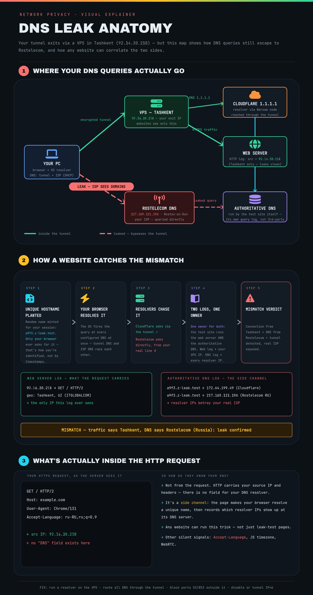

# sing-box DNS Leak Fix (VLESS + Reality + TUN)

A practical guide and ready-to-use configuration for running **sing-box** with a
**VLESS + Reality** outbound and a **TUN** inbound — without leaking your DNS
queries to your ISP.

Born from a real debugging session: a leak test showed the VPS exit IP working
fine while DNS queries were still answered by the ISP's resolvers. This repo
documents why that happened, the exact configuration that fixes it, and the
pitfalls encountered along the way (including two ways to accidentally kill
your internet connection entirely).



## Contents

- [`docs/dns-leak-explained.md`](docs/dns-leak-explained.md) — what a DNS leak
  is, how leak-test sites detect it (unique-hostname correlation through the
  authoritative DNS), and why the HTTP request itself reveals nothing.
- [`docs/troubleshooting.md`](docs/troubleshooting.md) — the three failure
  modes hit in practice and how each was diagnosed from sing-box logs.
- [`configs/client.json`](configs/client.json) — the final, working client
  configuration with all secrets replaced by placeholders.
- [`configs/server.example.json`](configs/server.example.json) — a minimal
  generic VLESS+Reality server-side example (adapt to your own setup).

## The short version

Three things must be true for leak-free operation:

1. **Hijack DNS at the TUN.** Without it, OS DNS queries to your ISP's
   resolver are merely *proxied* to that resolver — the ISP still sees every
   domain. The hijack must be scoped to DNS only (`protocol: "dns"` with a
   preceding `sniff` action), otherwise **all** TCP traffic gets thrown at the
   DNS module and nothing works.
2. **Resolve through the tunnel.** Use DoH/DoT with `detour` pointing at the
   proxy outbound, so even the resolver lookup exits from the VPS.
3. **Match IP versions to your server.** If your VPS is IPv4-only, do not hand
   out AAAA records — set `"strategy": "ipv4_only"` — or clients will try
   unreachable IPv6 destinations and stall.

## Quick start

```bash
# 1. Copy the client config and fill in YOUR_* placeholders
cp configs/client.json config.json

# 2. Validate
sing-box check -c config.json

# 3. Run (needs admin/root for TUN)
sing-box run -c config.json

# 4. Verify — should print your VPS IP
curl https://ifconfig.me
```

Then run an extended test on [dnsleaktest.com](https://dnsleaktest.com) —
you should see only your chosen resolver (e.g. Cloudflare), never your ISP.

## Security note

Never commit real credentials: VLESS UUIDs, Reality private/public key pairs,
`short_id` values, server IPs you don't want public. All configs here use
placeholders — keep it that way.
