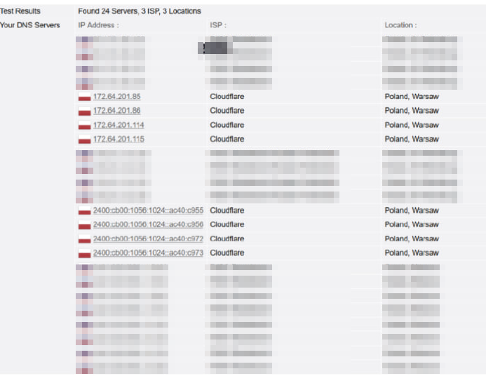
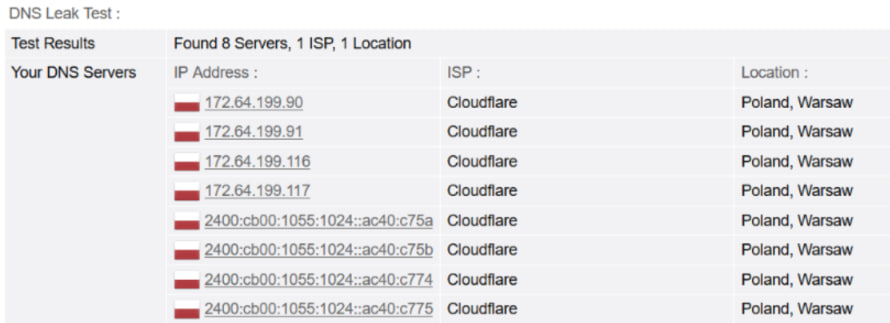

# sing-box Private Endpoint: Full Setup Guide + DNS Leak Fix (VLESS + Reality + TUN)

A complete, step-by-step guide for turning a fresh VPS into a personal
network endpoint with **sing-box** — **VLESS + Reality** on the server,
**TUN** on the client — including the DNS-leak fix this repo started with.

Born from real debugging sessions: a leak test showed the VPS exit IP working
fine while DNS queries were still answered by the ISP's resolvers — and later
a full server provisioning run distilled into a reusable guide. This repo
documents the protocol, the setup, the leaks, and the pitfalls (including two
ways to accidentally kill your internet connection entirely).


## Contents

**Understand it**

- [`docs/protocol-explained.md`](docs/protocol-explained.md) — how sing-box,
  VLESS, Reality, and the TUN/DNS path work, schematically, with a
  field-by-field cheat sheet for both configs.
- [`docs/dns-leak-explained.md`](docs/dns-leak-explained.md) — what a DNS leak
  is, how leak-test sites detect it (unique-hostname correlation through the
  authoritative DNS), and why the HTTP request itself reveals nothing.

**Do it**

- [`docs/server-setup-guide.md`](docs/server-setup-guide.md) — the full
  step-by-step guide: preflight → admin user + SSH hardening → install →
  secrets → server config → firewall → service → client profile →
  verification. Every phase has a PASS/FAIL gate and a rollback note.
- [`docs/llm-setup-prompt.md`](docs/llm-setup-prompt.md) — a ready-made,
  parameterized prompt: fill in the input block, paste it into a fresh LLM
  session with terminal access, and it configures a new server for you —
  with secret-handling rules and per-phase verification built in.
- [`scripts/bootstrap-server.sh`](scripts/bootstrap-server.sh) — the
  scriptable alternative: installs sing-box, generates secrets, writes and
  validates the server config, sets up UFW, starts the service, prints the
  client-side values once.

**Reference configs**

- [`configs/client.json`](configs/client.json) — the working client
  configuration with all secrets replaced by placeholders.
- [`configs/server.example.json`](configs/server.example.json) — a minimal
  generic VLESS+Reality server-side example (adapt to your own setup).

**DNS-leak specifics**

- [`docs/troubleshooting.md`](docs/troubleshooting.md) — the four failure
  modes hit in practice and how each was diagnosed from sing-box logs.
- [`scripts/Enable-DnsKillswitch.ps1`](scripts/Enable-DnsKillswitch.ps1) —
  Windows: block DNS on the physical interface at the firewall level, so the
  OS resolver can never bypass the tunnel.
- [`scripts/Disable-DnsKillswitch.ps1`](scripts/Disable-DnsKillswitch.ps1) —
  Windows: revert the killswitch and restore normal direct internet.

## The short version

Three things must be true for leak-free operation:

1. **Hijack DNS at the TUN.** Without it, OS DNS queries to your ISP's
   resolver are merely *proxied* to that resolver — the ISP still sees every
   domain. The hijack must be scoped to DNS only (`protocol: "dns"` with a
   preceding `sniff` action), otherwise **all** TCP traffic gets thrown at the
   DNS module and nothing works.
2. **Resolve through the tunnel.** Use DoH/DoT with `detour` pointing at the
   proxy outbound, so even the resolver lookup exits from the VPS.
3. **Match IP versions to your server.** If your VPS is IPv4-only, do not hand
   out AAAA records — set `"strategy": "ipv4_only"` — or clients will try
   unreachable IPv6 destinations and stall.
4. **On Windows, add a firewall killswitch.** The tunnel config alone cannot
   stop the OS resolver: Windows' DNS Client sprays queries on every adapter
   via interface-bound sockets that bypass TUN routes entirely. A
   firewall-level killswitch on the physical interface is required — see
   [`scripts/`](scripts).

## Quick start

```bash
# 1. Copy the client config and fill in YOUR_* placeholders
cp configs/client.json config.json

# 2. Validate
sing-box check -c config.json

# 3. (Windows only) Enable the DNS killswitch BEFORE starting sing-box,
#    so the OS resolver cannot bypass the tunnel:
powershell -ExecutionPolicy Bypass -File .\scripts\Enable-DnsKillswitch.ps1
#    (after you're done, restore normal internet with
#     .\scripts\Disable-DnsKillswitch.ps1)

# 4. Run (needs admin/root for TUN)
sing-box run -c config.json

# 5. Verify — should print your VPS IP
curl https://ifconfig.me
```

Then run an extended test on [dnsleaktest.com](https://dnsleaktest.com) —
you should see only your chosen resolver (e.g. Cloudflare), never your ISP.

## Verified results

The extended leak test, before and after applying this repo's fix (tunnel
config + Windows killswitch):

| Before | After |
| --- | --- |
|  |  |
| 24 servers, 3 ISPs, 3 locations — the ISP's v4 **and** v6 resolvers leak despite a correct sing-box config (failure mode 4). | 8 servers, 1 ISP, 1 location — Cloudflare only. The Warsaw geolocation is just Cloudflare's anycast egress, not a leak. |

## Security note

Never commit real credentials: VLESS UUIDs, Reality private/public key pairs,
`short_id` values, server IPs you don't want public. All configs here use
placeholders — keep it that way.
