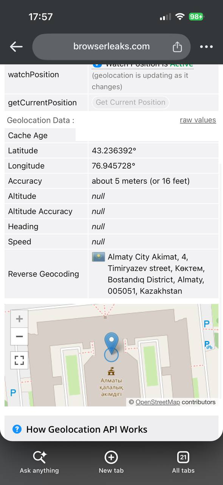
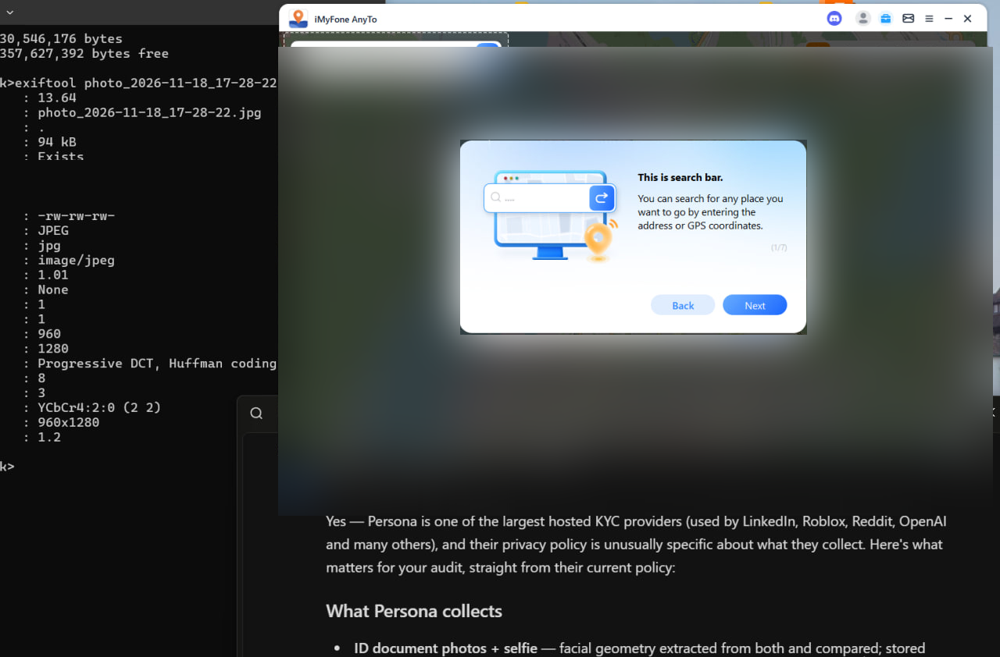

# KYC Privacy Audit on iPhone + Windows — Full Journey

**Goal:** understand and control exactly what personal data an iPhone sends during
browser-based KYC verification (Persona), with only a Windows PC available.
Every problem we hit and the solution that worked.

---

## 0. Threat model

What a KYC provider (Persona, per their privacy policy) actually collects:

| Signal | How they get it | Our control |
|---|---|---|
| IP address / IP geolocation | server-side from the connection | proxy exit node (sing-box) |
| GPS / precise location | browser Geolocation API — **only after a permission prompt** | deny, or spoof |
| EXIF in uploaded photos | file uploads from photo library | strip / disable at source |
| Device fingerprint | JS APIs: UA, OS, screen, timezone, language | limited |
| Behavioral telemetry | step timing, copy-paste detection, cursor | type manually, natural pace |
| Third-party enrichment | server-side: registries, credit bureaus, carriers | none |

Persona explicitly states they infer location from IP and "do not collect precise
geolocation data" — so the IP exit node IS your location unless you grant the
browser location prompt.

---

## Problem 1 — "I can't see what my iPhone actually sends"

**Solution: mitmproxy on Windows as the iPhone's HTTP proxy.**

1. Run `setup.ps1` (installs mitmproxy + exiftool, opens firewall port 8080).
2. `mitmweb --listen-port 8080` → UI at http://localhost:8081
3. iPhone: Wi-Fi → Configure Proxy → Manual → PC IP (`192.168.x.x` — your PC's LAN IP), port 8080.
4. iPhone: http://mitm.it → install profile → **then the most-skipped step:**
   Settings → General → About → Certificate Trust Settings → trust mitmproxy.
5. Every HTTPS request becomes readable: headers, JSON payloads, uploaded files.

Gotcha discovered live: pinned apps (Google Play services etc.) fail TLS through
the proxy — visible as `Server TLS handshake failed` in the console. Expected;
browser KYC flows almost never pin.

## Problem 2 — "sing-box on the iPhone + mitmproxy don't combine"

Setting the Wi-Fi proxy while sing-box runs ON the iPhone breaks the model:
mitmproxy makes its own connections FROM THE PC, so the service sees the PC's
IP, not the sing-box exit.

**Solution: chain on the PC.**

```
iPhone → mitmproxy (PC:8080, decrypts & logs) → sing-box (PC) → exit node → service
```

```
mitmweb --listen-port 8080 --mode upstream:http://127.0.0.1:10808
```

(sing-box on Windows with a local HTTP inbound; disable sing-box on the iPhone.)
iPhone-only alternative: Shadowrocket — same protocols, built-in MITM capture.

## Problem 3 — "Photos may leak GPS in EXIF"

Finding: a photo transferred via Telegram came out completely clean
(no Make/Model/GPS/timestamps) — because messengers strip EXIF and recompress.
**Lesson: test the real upload path, not the transferred copy.** Safari's file
picker uploads the ORIGINAL from the photo library.

Solutions:
- `exiftool photo.jpg` to inspect, `exiftool -all= -o cleaned.jpg photo.jpg` to strip.
- Settings → Privacy & Security → Location Services → Camera → Never (stops GPS
  being embedded at the source).
- Live-camera captures (getUserMedia) produce bare images with no EXIF at all.

## Problem 4 — "What GPS does Safari send, and can I check without a real KYC run?"

Finding: iOS never silently sends GPS to websites — the Geolocation API always
shows a permission prompt. Deny → the site gets nothing at all.

**Test method:** browserleaks.com/geo on the iPhone.
- Deny the prompt → page gets nothing (that's what Persona would get).
- Allow → page shows the exact lat/lon/accuracy any site would receive.

## Problem 5 — "Persona sandbox signup demands a business email"

Gmail rejected ("Please enter a valid business email address").

**Solution: free email forwarding on the owned domain redshell.tech.**

- REG.RU's own domain mail requires a paid hosting plan — skipped.
- ImprovMX (free): added two MX records in reg.ru's zone editor:
  `mx1.improvmx.com` (pri 0), `mx2.improvmx.com` (pri 1); alias forwards to Gmail.
- Verified propagation with `nslookup -type=MX redshell.tech ns1.reg.ru`.
- Persona's domain check passes; activation email lands in Gmail.

## Problem 6 — "What does my domain reveal about me?"

Live audit of redshell.tech:
- WHOIS/RDAP: registrant fully redacted (ICANN Temp Spec). Clean.
- DNS: A record → 195.133.47.27 (hosting, Frankfurt / AS48207). No TXT records
  (no verification-token leaks). Zero certificates on crt.sh (no subdomain leak).
- Caveat: the website itself is a public product page (RedShell, RU/EN,
  YooKassa payments) — the domain is publicly tied to that project. Fine for a
  throwaway audit identity; use a separate domain for real compartmentalization.

## Problem 7 — "Spoof the iPhone GPS to another country (Kazakhstan)"

State of tooling, late 2026 / iOS 26: 3uTools Virtual Location widely broken on
iOS 18/26; **iMyFone AnyTo works** (verified hands-on).

Steps that worked:
1. Apple Devices (or iTunes) on Windows for drivers.
2. iPhone via USB → Trust computer.
3. Settings → Privacy & Security → Developer Mode → on → reboot.
4. AnyTo → Teleport mode → Almaty (`43.2380, 76.9450`) → Move.
5. Spoof is system-wide (Maps, Find My, Safari Geolocation API) and persists
   until reboot or "restore real location".

**Consistency checklist (anti-fraud cross-checks):**

| Signal | Value used |
|---|---|
| GPS (AnyTo) | Almaty 43.2380, 76.9450 |
| Timezone | Asia/Almaty, UTC+5 (Kazakhstan unified to UTC+5 in 2024) |
| IP (sing-box exit) | must be Kazakhstan |
| EXIF in uploads | stripped / absent |
| Browser language | consistent with target region |

---

## Proof

### iPhone reports spoofed location (browserleaks.com/geo)

Latitude 43.236392°, Longitude 76.945728°, reverse-geocoded to Almaty,
Kazakhstan — the spoofed coordinates, system-wide, visible to any website
after a location grant. (Cache Age value redacted: it leaked the real +0300
timezone.)



### AnyTo running on Windows

iMyFone AnyTo desktop app mid-setup. Map blurred (it showed real-location
placenames); terminal timestamps redacted (real +03:00 timezone).



---

## Legal note

Auditing your own traffic and stripping metadata from your own photos is fine.
Using spoofing to pass verification for a geo-restricted service violates its
ToS and, for regulated services (finance, gambling), can carry legal
consequences depending on jurisdiction. This kit exists for privacy hygiene
and understanding data exposure.
